<p align="center">
  <picture>
    <source media="(prefers-color-scheme: dark)" srcset="assets/banner-dark.svg">
    <source media="(prefers-color-scheme: light)" srcset="assets/banner-light.svg">
    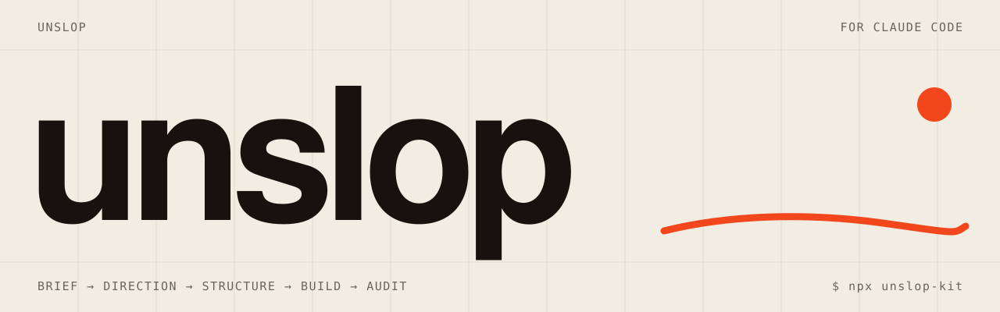
  </picture>
</p>

<div align="center">

<code>npx bangers-kit</code>

[](https://www.npmjs.com/package/bangers-kit)
[](https://github.com/buildwithrekt/bangers-kit/actions/workflows/ci.yml)
[](package.json)
[](#claude-code-plugin)

[Install](#install) · [Example](#an-example-session) · [Showcase](#built-with-bangers-kit) · [Commands](#commands) · [Skills](#skills) · [Tutorial](TUTORIAL.md)

</div>

---

**Bangers kit** makes Claude Code work the way a senior web designer would. It asks a few questions, proposes an art direction, waits for your yes, then builds and audits its own work. You get the method behind award-level sites (Awwwards, FWA, CSS Design Awards), plus the production pipelines around a launch: brand kit, press kit, redesign threads and films.

One command starts a site. The always-on rules keep the agent on the method for every session after that.

## Install

All routes need [Claude Code](https://claude.com/claude-code) and Node 22 or later.

### The installer (recommended)

```bash
npx bangers-kit
```

```text
┌  Bangers kit v0.2.0
│
◆  Which skills?
│  ◼ motion-system (tokens, smooth scroll, reveals, transitions, WebGL loading)
│  ◼ brand-kit (logo set, OKLCH tokens, favicons, OG images, guidelines)
│  ◼ press-kit (press page, exports, X kit, motion loops)
│  ◼ redesign-thread
│  ◼ code-film
│  ◼ scroll-film
│
◆  Install where?
│  ● Everywhere (~/.claude, every project)
│  ○ This project only (./.claude and ./CLAUDE.md)
│
◆  Install the always-on rules and the design watch?
│  Yes
└
```

The commands are installed as `/bangers-awwwards` and `/bangers-scout`. To skip the prompts, `npx bangers-kit --yes` installs everything globally, and `npx bangers-kit --help` lists every flag.

### Claude Code plugin

```text
/plugin marketplace add buildwithrekt/bangers-kit
/plugin install bangers@bangers-kit
/bangers:setup
```

`/bangers:setup` copies the rules and the design watch into `~/.claude/bangers` and adds one import line to your user-level `CLAUDE.md`. Start a new session afterwards. With the plugin, commands are namespaced: `/bangers:awwwards`, `/bangers:scout`.

### Skills only

```bash
npx skills add buildwithrekt/bangers-kit
```

Copies the six skill folders and nothing else: no rules, no design watch, no commands. Use this route for other agents, or if you only want the skills.

Then, for the design watch and the render scripts:

```bash
npx playwright install chromium
```

## An example session

One brief, typed into Claude Code:

```text
/bangers-awwwards A landing page for a specialty coffee roaster in Lisbon.
Warm, editorial, a bit playful. One page, with a shop link.
```

Claude does not start coding. It works through five steps and stops three times for your approval:

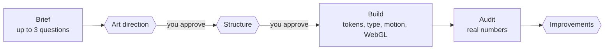

The art direction step looks like this (abridged). Every choice points back to a pattern from the design watch, and nothing is copied from the sites it cites:

```text
Art direction: "Torra" roastery

Palette (OKLCH)
  --paper   oklch(95% 0.02 80)    warm cream, never pure white
  --ink     oklch(22% 0.02 50)    roasted brown, never pure black
  --signal  oklch(66% 0.19 40)    one terracotta accent, for the shop CTA only

Type
  Display   a variable grotesk at weight 450, tracking -4%, headlines up to 180px
  Script    one handwritten word per section, laid over the grotesk
  Labels    a mono at 12px for origins, altitudes and roast dates

Motion
  Lenis smooth scroll, synced with ScrollTrigger
  Easings exposed as CSS tokens and reused in GSAP
  Roles: entrances stagger by line, emphasis by word, transitions by mask

Wow moments
  1. The hero title holds a photo between two words, full width
  2. A roast curve drawn as you scroll, with the beans' temperature as data
  3. Footer: the logotype split across both corners, monumental and pale

Inspired by: image inside the title, script over grotesk, SVG line drawing,
             earthy palette with a single signal accent (design-references.md)
Avoided:     identical fade-ups on every block, default Google fonts in display,
             a loader that blocks the page

Approve, or tell me what to change.
```

This is where most of the quality comes from. Push back: "the palette is too safe", "bigger type", "I want one moment that makes people stop scrolling". Once you approve, Claude proposes the structure, then builds. It reports real build, Lighthouse, accessibility and SEO results before it calls the work done, failures included.

The [tutorial](TUTORIAL.md) walks through a full session and each skill.

## Built with Bangers kit

Five live sites, each with its own art direction. Desktop on the left, the same page on a phone on the right. Click any capture to open the site.

<table>
  <tr>
    <td width="76%"><a href="https://maisonpixel.si">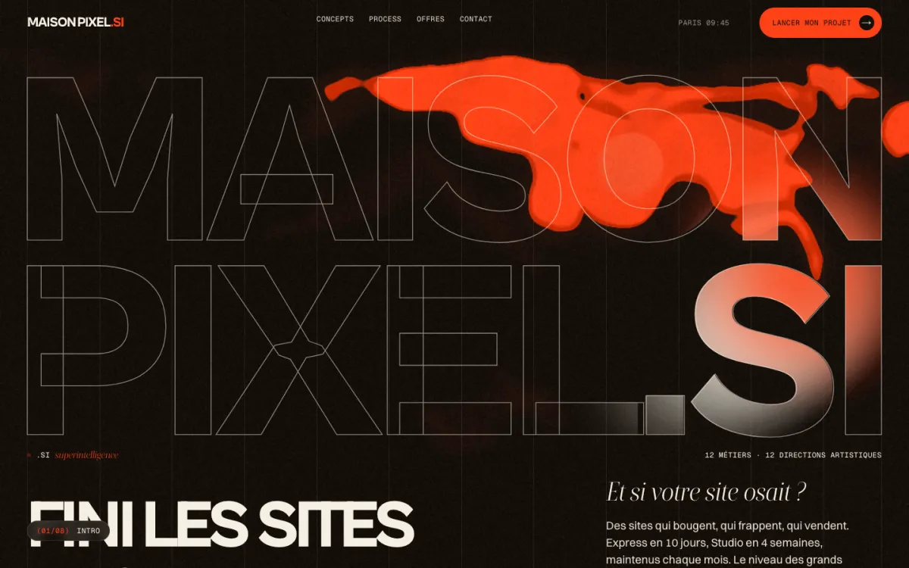</a></td>
    <td width="24%"><a href="https://maisonpixel.si">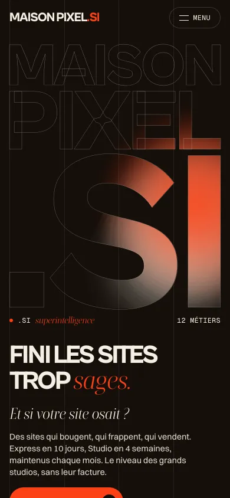</a></td>
  </tr>
  <tr>
    <td colspan="2"><b><a href="https://maisonpixel.si">Maison Pixel</a></b>: a web studio selling animated sites. Outlined display type at full width, a liquid shape in signal orange, an italic serif against a heavy grotesk, and the studio's local time in the header.</td>
  </tr>
  <tr>
    <td><a href="https://www.undrlst.com">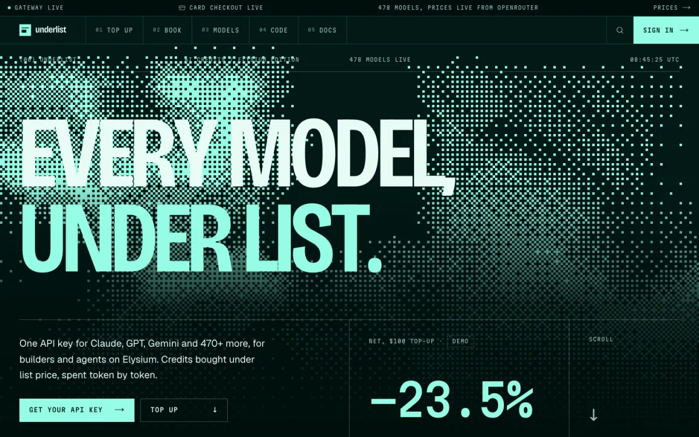</a></td>
    <td><a href="https://www.undrlst.com">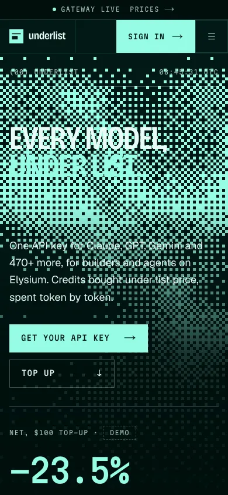</a></td>
  </tr>
  <tr>
    <td colspan="2"><b><a href="https://www.undrlst.com">underlist</a></b>: one API key for every AI model, bought below list price. A dithered mint field behind a tall condensed headline, a live status bar and mono labels: the "instrument" look.</td>
  </tr>
  <tr>
    <td><a href="https://gitcap.fun">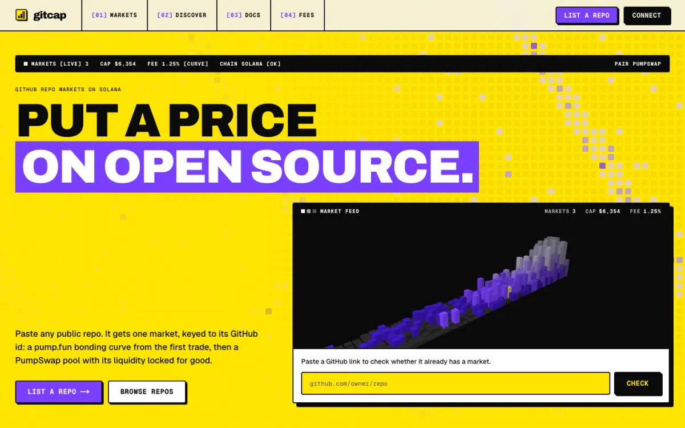</a></td>
    <td><a href="https://gitcap.fun">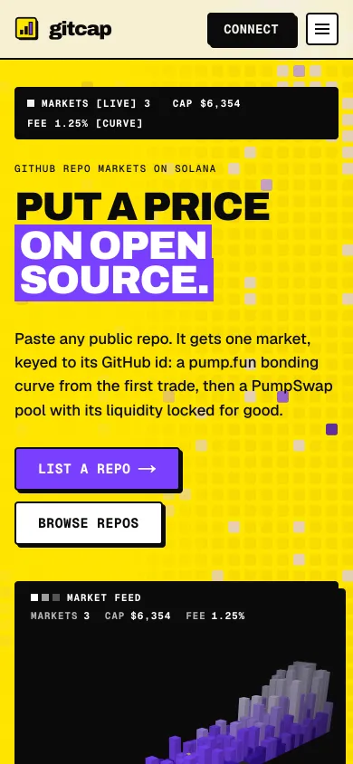</a></td>
  </tr>
  <tr>
    <td colspan="2"><b><a href="https://gitcap.fun">gitcap</a></b>: GitHub repositories traded as markets on Solana. Signal yellow and violet, a numbered nav, a ticker strip and a 3D market feed built from live data.</td>
  </tr>
  <tr>
    <td><a href="https://retikl.fun">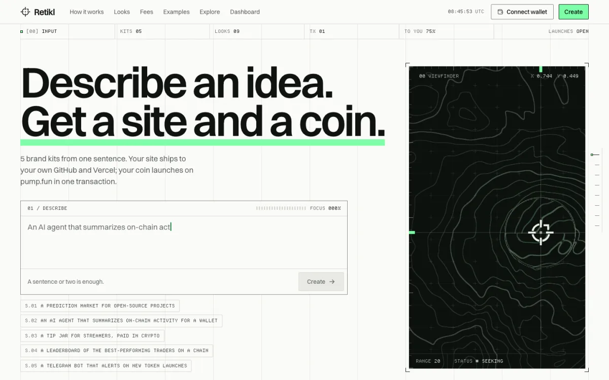</a></td>
    <td><a href="https://retikl.fun">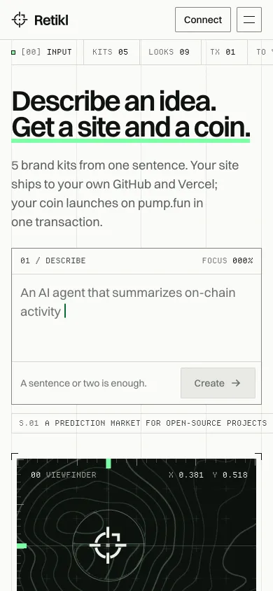</a></td>
  </tr>
  <tr>
    <td colspan="2"><b><a href="https://retikl.fun">Retikl</a></b>: one sentence in, a site and a coin out. A strict paper grid, a viewfinder that hunts across a contour map, and the prompt field as the hero.</td>
  </tr>
  <tr>
    <td><a href="https://riprr.io">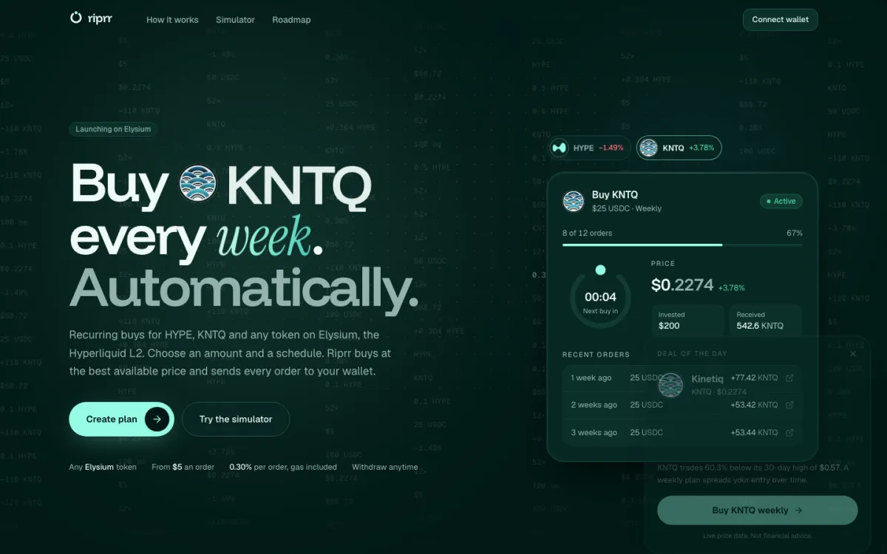</a></td>
    <td><a href="https://riprr.io">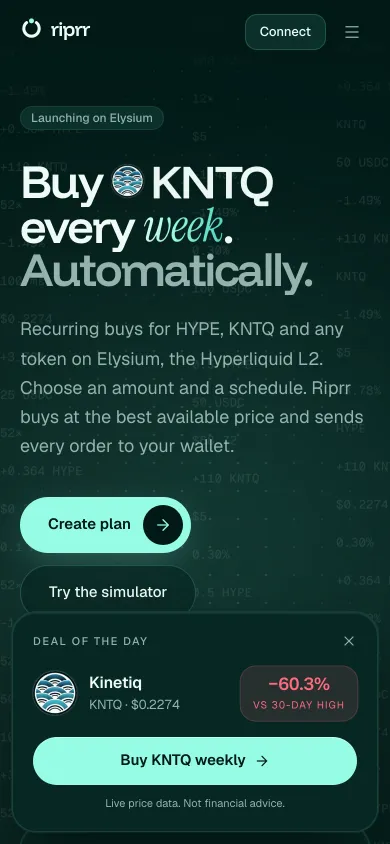</a></td>
  </tr>
  <tr>
    <td colspan="2"><b><a href="https://riprr.io">Riprr</a></b>: scheduled buys of any token on Elysium. A headline that rotates token and cadence, an italic accent word, and a working order card with live prices.</td>
  </tr>
</table>

## Commands

| Command | What it does |
|---|---|
| `/bangers-awwwards <brief>` | Brief, art direction, structure, build, audit and improvements, with validation stops |
| `/bangers-scout [theme]` | Re-runs the design watch on recent Awwwards Sites of the Day and Dribbble, and appends to your design references |

With the plugin, write them `/bangers:awwwards` and `/bangers:scout`. The plugin adds `/bangers:setup`, which installs or refreshes the rules and the design watch.

## Skills

Claude loads them when the work calls for them. You can also name one: "use the press-kit skill".

| Skill | Use it for | Try |
|---|---|---|
| `motion-system` | Tokens, smooth scroll, text reveals, page transitions, preloader, cursor, WebGL loading, accessibility | *"Add a page transition between home and the work pages."* |
| `brand-kit` | Name, logo set, OKLCH tokens, type, favicons, OG images, social banners, guidelines page | *"Make a brand kit for a budgeting app for freelancers. Calm, not corporate."* |
| `press-kit` | Press page, logo and banner exports, X kit, motion loops to MP4, zip bundles | *"Build the press kit and X kit for this site."* |
| `redesign-thread` | Unofficial redesign of an existing site as a thread of images built on real data | *"Make a redesign thread for &lt;site URL&gt;."* |
| `code-film` | A film written in code and rendered frame by frame to video | *"Make a 30-second launch film, landscape plus vertical."* |
| `scroll-film` | A scroll-driven film from generated shots, with a hard spending cap | *"Add a scroll film to the hero, 4 shots. Show me the cost first."* |

## What the rules enforce

- At most three questions, then an art direction proposal before any code
- Current library versions checked before every install, never taken from memory
- Every imported component re-tuned to the art direction
- `prefers-reduced-motion`, keyboard, focus, contrast and semantic HTML under every WebGL scene
- Performance, mobile, accessibility and SEO audited with real results before "done"
- Inspiration, never copying: no code, asset, text or identity taken from another site

## Update

- Installer: run `npx bangers-kit@latest` again.
- Plugin: `/plugin marketplace update bangers-kit`, then `/plugin update bangers@bangers-kit`, then `/bangers:setup`.

Your design watch is never overwritten. The rules are refreshed, and your previous copy is kept as `rules.md.bak`.

## Requirements

- Node 22 or later
- Chrome or Chromium for the render scripts, and Playwright for the watch and the redesign captures: `npx playwright install chromium`
- `ffmpeg` for motion loops and films
- `scroll-film` only: a fal.ai key in `FAL_KEY` and a cap in `FILM_BUDGET`. Generation costs money. The script prints an estimate and refuses to run above the cap. Check model prices again before each run.

Each skill lists its own npm dependencies. The kit installs nothing globally.

## Companion skills (optional, third-party)

These are not part of the kit and are not redistributed. Install them from their own sources and check their licences:

```bash
npx skills add anthropics/skills -g                       # frontend-design
npx skills add nextlevelbuilder/ui-ux-pro-max-skill -g    # ui-ux-pro-max
npx skills add coreyhaines31/marketingskills -g           # copywriting, SEO, launch, pricing and more
```

## Licence

The source is public so that it can be installed, but the kit is not open source. You may install and use it for your own and your clients' projects. Redistribution and resale are not allowed. Read [LICENSE](LICENSE) for the details. Work you produce with the kit is yours.
